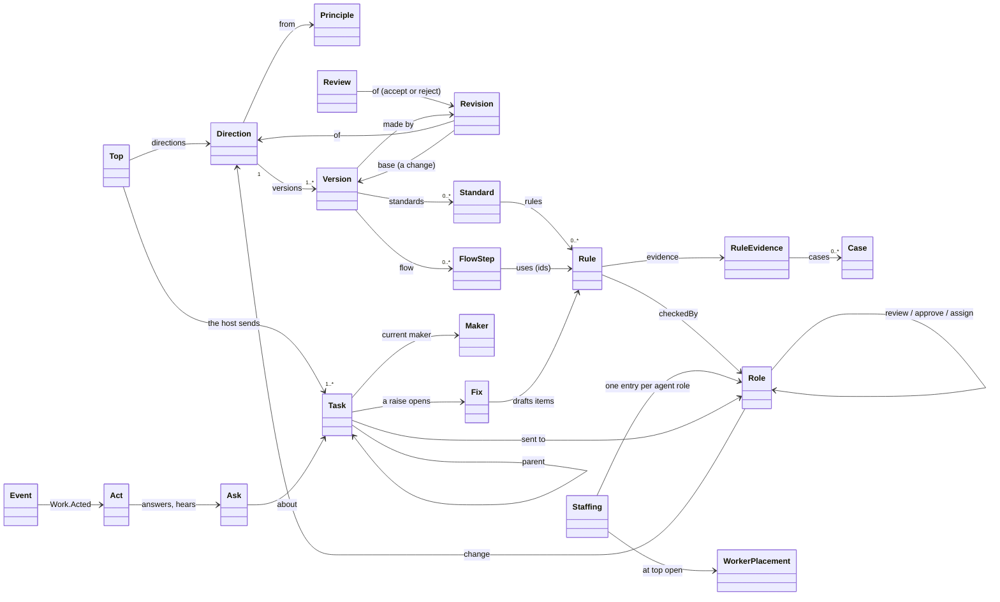

# aristoteles

`work` is a command line for AI work under review: each result of an AI is checked by a reviewer
before it counts. A person sets the directions; AI makers do the tasks; AI reviewers check each
result against the rules of the directions. The person accepts only the directions and their
changes. aristoteles is the store of this work: one SQLite file that links each task to the
version of the direction that it used.

This page has three parts: the principles that every direction grounds in, the types of
aristoteles with their properties and how they connect, and how to run it.

## The principles

A direction names the one or two principles whose question it answers (`from:` in its file).
There are eleven.

| Principle | The question it asks | What it asks an agent to do |
|---|---|---|
| Logos | Can we explain the requirement and its reasoning? | Write each requirement as a rule, with its reason and one worked example. |
| Pathos | Can the human understand the work, the result, and the trade-offs? | Write for the reader of the result: who does what, what happens next, every known limit. |
| Ethos | Which tests and checks support this result? | For each claim, name the check that supports it and the exact commits checked. |
| Mythos | Do our code patterns still fit the company direction? | Follow the company's code patterns; challenge a pattern that does not fit the code you change. |
| Oikos | How does the team work, review, and argue together? | Anyone may challenge any instruction or decision, also one from a higher level. |
| Nomos | Which policies and ways of working control the action? | Keep the policies: a purpose change needs the human; read-only places stay read-only. |
| Telos | Which purpose has the human accepted, and should it change? | Keep the accepted purpose; when the work shows it is wrong, propose a change with its consequences, and the human decides. |
| Kairos | Can the work pause and continue in another session or model? | Before you stop, save what is open: rejects, unfinished reviews, questions, outside actions with an unknown result. |
| Mnēmē | Which past attempts and lessons must we keep, with their evidence? | Keep each rejected attempt, its reason, the instruction change, and what happened next. |
| Topoi | How can a later task find past lessons, and see if they changed? | When a task starts, find lessons by topic, each with its status. |
| Aporia | Which questions are not answered, and which decisions need the answers? | Write down what you cannot decide, what needs the answer, and who could answer it. |

`work guide writing` gives the same questions to the agents that draft directions.

## The types

Every type below is the shape the code uses (`src/domain`, `core/state`, `src/config`). Four
rules hold for the records:

- A record names another record by its id, never by holding it. Records are immutable: a change
  makes a new copy.
- `_tag` is the tag of every union.
- `when` is the time of an act; `at` is a record's place among all records.
- A record has no optional field: a missing value that something reacts to is a member of a
  union. (The files you write may leave keys out.)

### How they connect



### Directions

**Direction**: what the work is for. It is drafted first, and becomes official when its first
version is accepted.

| Property | Type | Meaning |
|---|---|---|
| `id` | DirectionId | lower-case words with dashes, e.g. `tsd-writing` |
| `name` | text | |
| `owner` | Human | the person who accepts its drafts |
| `from` | Principle[] | the principles it grounds in |
| `maxStandards` | `Unlimited \| AtMost { max }` | the most standards it may hold |
| `source` | `Local \| External { repo, path }` | written in this dir, or a folder of a company repo |
| state | `NewDirection \| Official { versions }` | drafted with no version yet, or official with at least one version |

**Version**: one official version of a direction. Its id is `<direction>@<number>`
(`tsd-writing@2`); the last one is current.

| Property | Type | Meaning |
|---|---|---|
| `of` | DirectionId | |
| `number` | positive integer | 1, 2, 3 |
| `revision` | RevisionId | the draft that made it |
| `summary` | text | one or two plain sentences for a first-time reader |
| `flow` | FlowStep[] | how the direction works, from the first act down to the output |
| `says` | text | the words of the direction |
| `standards` | Standard ids | |
| `when` | time | |

**Revision** (a draft, `d3`): a new direction, or a change of a version. It is official once a
Review accepts it.

| Property | Type | Meaning |
|---|---|---|
| `id` | RevisionId | `d<n>` |
| `of` | DirectionId | |
| kind | `New \| Change { base: VersionId }` | |
| `summary`, `flow`, `says`, `standards` | | the content it proposes |
| `origin` | `Written { by: Agent } \| Onboarded { event } \| Imported { commit, ref }` | a model of this dir wrote it, onboarding started the store with it, or the daily refresh imported a company commit |
| `answers` | RejectId[] | the rejects it answers |
| `why` | `NoneGiven \| Given { reason, words }` | reason: correct the rule, the standard, the direction, the reviewer, or shorten |

**Review** (`v4`): the owner's act on a draft: `Accept { reason }` makes its version;
`Reject { reason }` ends it. Both carry `id`, `by: Human`, `of: RevisionId`, `when`.

**Standard**: how the output looks.

| Property | Type | Meaning |
|---|---|---|
| `id` | text | e.g. `facts-not-proof` |
| `says` | text | |
| `where` | `Everywhere \| Where { conditions }` | where it applies: each condition a context key (`section`, `system`, `field`, `language`, `repo`, `audience`, `output`) with the values that match |
| `rules` | Rule ids | |

**Rule**: one check that a reviewer does on one result of a maker.

| Property | Type | Meaning |
|---|---|---|
| `id` | text | unique in the project, e.g. `no-ticket-ids` |
| `says` | text | the one check |
| `test` | shell command | no output: the rule holds; each printed line is a point |
| `ref` | `file#anchor:lines` | the text a checker reads |
| `checkedBy` | `Decider \| Role { role }` | the role that checks it, or the decider of the result |
| `evidence` | RuleEvidence | |
| `supersedes` | Rule ids | the rules it replaces |

**RuleEvidence**: why the rule holds where it is used.

| Property | Type | Meaning |
|---|---|---|
| `scope` | `{ searched, unknown }` | what was searched, and what is not known |
| `check` | `Command { result } \| Reference { checker, result } \| Absent \| Unknown { question }` | how it is checked, and what the check returned |
| `cases` | Case[] | outputs that pass and outputs that fail |
| `knownBreaks` | Spot[] | places that break it today |

**Case**: `{ fit: Follows | Breaks, input?, output }`. The input is what the maker or checker
received (an instruction, or the file it worked from); a passing and a failing case share it.
Each sample is a **Spot** `{ file, line, excerpt }` of the project, or `{ written }` text,
labelled made up.

**FlowStep**: one act of the flow: `{ from, to, says, place: { file, line } }`. A marked step
also has `uses`: the direction, standard and rule ids that govern it. The rules a marked step
uses hold at least one passing and one failing case.

### The project: `aristoteles.yaml`

It holds the people, the roles, who decides, and the display settings (`retryMinutes`,
`hostWaitMinutes`, `outsideSourceHours`, `sound`, `theme`). Models and staffing live in
`.work/staffing.yaml`.

**Role**: an agent (a model) or a program (a check command).

| Property | Type | Meaning |
|---|---|---|
| `description`, `intro`, `responsibilities` | text | the words of the role |
| `output` | text | its output form, e.g. `<file>#<section>` or `<repo>@<commit>` |
| `acts` | Act[] | `do`, `review: [roles]`, `approve: [roles]`, `assign: [roles]`, `change: [directions]`, and the authorities `split`, `direct`, `fit` |
| `checks` | Rule ids | the rules it checks |
| `icon` | one of the page's icons | its card |
| `pipeline` | boolean (agent) | the one role that evaluates every raise and runs the direction pipeline |
| `run`, `on: report`, `timeout` | (program) | the command it runs on each report |

The host is the persistent agent role with `split`. **decide** names, for each maker role, who
decides its results: a role, or `{ or | and | order: [...] }` of them.

**Fit**: a role's fit record: `{ hash, by, answers }`, one yes with its reason for each question
of `guides/fitness.yaml`. A role with no fit for its current words gets no work.

### Staffing: `.work/staffing.yaml`

Who runs each agent role, outside git.

| Key | Properties |
|---|---|
| `models.<model>` | the commands of a model (`launch`, `resume`, `start`, …) and its limits |
| `clis.<cli>` | `backgroundChildren` (it runs subagents in the background), `canPark` (it can checkpoint and resume a session) |
| `accounts.<account>` | `limits` (as you type them, shown only), `sessionLimit` (sessions this dir runs at once on it) |
| `roles.<role>` | `account`, `cli`, `allowedModels`, `model`, `persistent`, `concurrency` (attempts at once), `subagentAllowance` (children at once), `launch` (with `{session}`), `workerGroup` |

At top open, staffing becomes the runtime:

- **WorkerPlacement**: where actors run: `{ worker, account, cli, model, launch, members,
  sessionLimit, canPark, resume }`. A worker is `role:<name>`, or `group:<g>` for the persistent
  roles that share a `workerGroup` (one session, one wait).
- **AdmissionPolicy**: per actor: `{ concurrency, subagentAllowance, backgroundChildren }`.
  An attempt is admitted as a background child, as a serial turn in the role's own session, or
  waits (refused `cap`) with its reason on the page.

### The work

**Top**: the person's task, held by the host: `{ name, goal, sections, facts, directions, done, ended }`.

**Task**: a part the host sends to a persistent role.

| Property | Type | Meaning |
|---|---|---|
| `id`, `name`, `goal` | | |
| `role` | role name | the persistent role it is sent to |
| `parent` | task id or none | the task it is part of |
| `sections`, `directions` | | what it covers |
| `facts` | context map | inherited context and any facts added by this task |
| `state` | `Sent \| Working \| InReview \| Raised \| Done \| Split` | |
| `tries` | number | attempts so far; a raise follows the last one |
| `maker` | maker id or none | the current maker |
| `checked`, `pending`, `caught` | rule and standard items | the item versions it was checked on, those still to check, and the test rules that print on its latest result |

**Maker**: a disposable worker on one task: `{ id, task, brief, revisions, ended }`. The role
sends it the review points, and the same maker works again.

**Fix**: what a raise opens for the pipeline role: it climbs from the evaluation to the level
that fails (`Principle`, `Direct`, `Standard`, `Fit`, `Split`), drafts the items or the role
card, tests them, runs its review loop, and reaches the person. Its `stage`, its draft items,
its role draft, its review mode (`other provider`, `fresh subagent`, `self-review turns`) and its
summary for the person are on it.

**Ask**: an obligation one actor puts on another: `{ id, kind: Question | Execute | Check |
Decide, from, to, about: Task | Fix | None }`. A question has a form: `Single`, `Multiple`,
`Choice` or `Matrix`, and its answer fits that form.

**Actor**: `Human`, `Host`, `Role { name }`, `Pipe`, `Harness`, or `Maker { id }`; on the
wire `human`, `host`, `pipe`, `harness`, `role:<name>`, `maker:<id>`. Each acts with a token
of its current epoch.

**Act**: what an actor sends to the store: `{ id, who, ep, seen, vers, body }`. Its body is one
of: `Open` (a question, a send, a maker, a reject), `AnswerQuestion`, `Hear`, `AskRaise`,
`ReadBrief`, `Resume`, `Report` (a maker's result), `Review` (`Pass | Fail | RaiseTries |
RaiseNoRule | RaiseMisses`), `Evaluate`, `Advance`, `WriteRule`, `RunTest`, `Ship`,
`LoopReview`, `Respond`, `Reassign`, `TopDone`, `RecheckDone`, `RunRule`, `Revive`, `Exit`,
`EndProject`, `MoveHost`, `AskEdit`. `work wait` prints the next step an actor owes.

### Workers

**Turn**: one step offered to a worker: `{ worker, generation, turn, actor, epoch, step }`;
the act it answers carries a receipt. **ChildReservation**: a background subagent reserved for
a maker, a review, or a recheck, released when it reports or exits. **Permits**: the attempts
each role holds and the fixes the pipeline holds, read from the accepted acts. A recheck runs
on its own lane; a worker that can park saves a checkpoint and frees its session slot.

### Activation and onboarding

Onboarding works on files (`.work/assess/`): each direction file has its `stage` (`Drafting`,
`Question`, `Answered`, `Revising`, `Ready`, `Accepted`, `Removed`), and a question targets two
candidate sources, or a deviation between the code and the stated principle. Approving all
roles writes the store **inactive**: every work act is refused `inactive` until activation
records `Workflow.Activated { generation, launch, hostVerifier }`, with the instruction-file
marker lines applied and the host's launch acknowledged.

### The store

One SQLite file, format 10. Each event is **Recorded** `{ seq, at, author, event }`, and only
its author kind may write it. **Author**: `Person { name, channel: terminal | ui }`,
`ModelRun { name, at }`, `System`, `Supervisor { name }`, `Refresh`.

| Group | Events |
|---|---|
| Workflow | `Defined` (the config, the onboarded directions, the activation), `RoleWordsChanged`, `Activated`, `HostRebound` |
| Role | `Fitted` |
| Revision | `Drafted`, `Revised`, `Imported`, `ExamplesAdded` |
| Review | `Accept`, `Reject` |
| Source | `Moved`, `Checked` |
| Send | `Sent`, `Delivered`, `Dropped` (text typed into a terminal) |
| Work | `Opened` (the top, its items, cards, tokens, placements), `Acted`, `HostPane`, `Forwarded`, `ForwardDropped` |
| Runtime | workers (`WorkerReserved`, `WorkerBound`, `WorkerFenced`, `WorkerEnded`), turns (`TurnOffered`, `TurnClosed`), children (`ChildReserved`, `ChildStarted`, `ChildBound`, `ChildReleased`), rechecks, checkpoints and parking |

### Refusals

A refused act changes nothing and says why, with the next step when there is one:
`{ refused, words, next }`.

| Name | When |
|---|---|
| `ended` | the project has ended |
| `authority` | the actor may not do this act |
| `epoch` | the token is of an old epoch or a gone worker |
| `legal` | the act is not allowed in this state |
| `basis` | the act was built on an old basis |
| `build` | the page is an old build |
| `stale` | the named ask or job is closed or replaced |
| `form` | an answer or report does not fit its form |
| `pair` | one open question per ordered pair of actors |
| `cap` | a limit holds: the question cap of a pair, or an attempt that must wait for capacity |
| `heard` | the answer was heard already |
| `terminal` | an act for a terminal: run `work run continue` |
| `inactive` | the project is not activated yet |

## Requirements

- [Bun](https://bun.sh) 1.4.3 or later (tested with 1.4.4). On macOS, an older Bun can wait for
  ever in a sync spawn (oven-sh/bun issue 34069), and the page's terminals then stop. Install it
  as https://bun.com/docs/installation says (on Linux its installer needs `unzip`), and put
  `~/.bun/bin` on the PATH of the shell that runs your AI CLI.
- git.
- tmux 3 or later, for the terminals of the agents.

## Start from your AI CLI

Open the AI CLI that you use (Claude Code, Codex, or another) in the dir, in a tmux pane, and
paste this prompt into it. That session is the host: it gets aristoteles, installs its skill in
the dir, onboards a new dir with you, starts the page, and starts or continues a project with
you. The page shows that same terminal, so you talk with the host there or on the page. No step
guesses which CLI you use.

```text
Use aristoteles in this folder.
1. Find aristoteles. When `work` is on the PATH, it is a link to <the aristoteles folder>/bin/work.js.
   If not, run: git clone https://github.com/nandanugg/aristoteles.git ~/.aristoteles/code
   Then run `bun install --production` in that folder (Bun 1.4.3 or later, git and tmux are
   necessary), and link the CLI (and put ~/.local/bin on the PATH when it is not there):
   mkdir -p ~/.local/bin && ln -s ~/.aristoteles/code/bin/work.js ~/.local/bin/work
   When `work` is still not on the PATH, use `bun <the aristoteles folder>/bin/work.js` in its place.
   Then run `work skill install` in this folder: it links the /aristoteles skill here, out of git.
2. Read <the aristoteles folder>/skills/aristoteles/SKILL.md and do what it says: you are the host.
```

`work skill install` links the skill in `.claude/skills/aristoteles` and
`.agents/skills/aristoteles`, and lists both links in `.git/info/exclude`. When you activate the
project, aristoteles adds one marker line to each `CLAUDE.md` and `AGENTS.md` that your CLIs
load, after you approve the list of files: a session whose first prompt is an aristoteles launch
ignores that file, and every other session of the dir reads your files as before. Rolling back
the activation restores the files.

In a new dir, the host onboards the dir with you. Onboarding works on files, and nothing goes to
the store until the end:

1. The host reads the dir and drafts the people and the roles (each with a one-line summary, and
   the place where the project has it already). It opens the page (`work start --detach`).
2. The host drafts each direction: its summary, its flow (the page draws it as a sequence
   diagram, the steps that the direction governs marked with their ids), its standards and its
   rules. Each rule shows its check (a test command, or the prompt its checker gets) and its
   cases: the input once, then an output that passes and one that fails, real when the project
   has one, else made up and labelled so. Accept a direction; or write what to change and press
   Revise; or remove it. When the host needs an answer, it asks on the rule: A, B, or your own
   words. You can add a direction (the principle, and an example if you have one) or a company
   direction: a folder of a git repo that other projects follow; for an example, see
   https://github.com/nandanugg/aristoteles-example-direction.
3. When every direction is accepted or removed, the roles page opens: a card for each role, with
   its icon and its responsibilities. Accept, revise, or remove each role.
4. Staffing: choose for each agent role its account, CLI, model and whether it is persistent;
   the page shows what the arrangement means for each limit before you apply it.
5. Approve all roles. That starts the store, inactive, with only the accepted result (at a
   terminal: `work onboard approve-roles`; the page and the command ask you to type the word
   `approve`). Then activate: approve the marker lines, and the host is launched and bound. Commit
   `aristoteles.yaml`. The host records the fit of each agent role.

Each page act has a twin at a terminal: `work onboard status` shows each direction and role with
its state, `work onboard accept <id>`, `revise <id> --words=<words>`, `remove <id>`,
`approve-directions`, and the role commands (`accept-role`, `revise-role`, `remove-role`).
`work activation ack|resume|rollback|relaunch` drive the activation.

After the store starts, a change of a direction is a draft that you accept. A role that directs
drafts it with `work direction revise`, and it waits for you on the page: accept it, or reject it
with your reason.

Then the host asks: a new project, or continue one? After the first start, the `aristoteles`
skill is linked in the dir, so you trigger it by its name. When the host's AI CLI ends, trigger a
host again and continue the project there: the page never starts or restarts a host.

## Use it by hand

```sh
git clone https://github.com/nandanugg/aristoteles.git
ln -s "$PWD/aristoteles/bin/work.js" ~/.local/bin/work   # or run: bun aristoteles/bin/work.js
```

In a dir (a folder of your work):

1. Write `aristoteles.yaml`: the people, the roles with their acts and icons, and `decide`. Its
   first line can name the schema, so an editor completes the keys:
   `# yaml-language-server: $schema=<the aristoteles folder>/schema/aristoteles.schema.json`.
2. Write `.work/staffing.yaml` (below).
3. Run `work init`.
4. A model drafts each direction with the `assess` skill (`skills/assess`), or with
   `work direction new --file=<direction.yaml> --by=<name>` (a lower-case name that the model
   gives itself).
5. The owner reads each draft (`work direction show <draft>`) and accepts or rejects it
   (`work direction accept <draft>` or `work direction reject <draft> --reason=...`).
6. Open the top: `work top open --name=... --goal=... --sections=a,b`. In your own tmux pane,
   start your AI CLI and have it run `work run continue`: that session is the host. `work start`
   starts the pipeline role and the roles in their terminals.

A staffing file:

```yaml
models:
  model-a:
    launch: 'agent --model model-a --session-id {session} {prompt}'
clis:
  coding-agent:
    backgroundChildren: false
    canPark: false
accounts:
  primary:
    limits:
      sessions: "2 sessions"
    sessionLimit: 2
roles:
  lead:
    cli: coding-agent
    account: primary
    allowedModels: [model-a, model-b]
    model: model-a
    persistent: true
    concurrency: 1
    subagentAllowance: 0
    launch: 'agent --model {model} --session-id {session} {prompt}'
```

Every agent role has an entry; a program role runs its checks without one.

`work` with no command prints all the commands. It exits 0 on success, 1 on a refusal, 2 on a
mistake in the command line, 3 when something outside fails (git, tmux, a fetch, a busy or
damaged store), and 70 on a bug.

The store is `~/.aristoteles/aristoteles.db` (`ARISTOTELES_DB` names another file). A store of
an older format is refused, unchanged, with the way to start a fresh one.

The first `work` call after a `git pull`, an edit of the code or a `bun install` builds the CLI
into one file in `.cache/cli/` of the aristoteles folder (git ignores it), and the calls after it
start from that file. A build that fails changes nothing: that call runs the code as it is.

## The UI: `work start`

`work start` in a dir opens its page in the browser: the dashboard (the task queue, the host,
the workers with their roles and the reason a step waits, the pipeline row with the escalations
that wait for you), and the real terminal of each AI agent. It needs `bun install` once in the
aristoteles folder, and tmux for the terminals.

It prints the page's address, `http://127.0.0.1:<port>/`, and the addresses for other machines
(`http://<an address of this machine>:<port>/`). The server listens on every interface, with no
key: anyone on the same network can open the page and type into the agents' terminals, so run
it only on a network that you trust. It answers only a request that names this machine (any
other host name gets 403), and an act and the terminals need the page's own origin. Set
`WORK_PORT` to keep the same port across starts. A machine with no browser opener (a server
over ssh) only prints the addresses.

- **A project is a talk** with the host, the AI CLI that you triggered: the page shows its
  terminal. Tell it what you want; it drafts the top task, and you open it with one click.
- **Persistent agents and subagents.** A persistent role runs in a real terminal that you can
  open and type into, from its first assignment to the end of the project; it takes its work
  with `work wait <token>`, one step at a time. A role that is not persistent runs as a subagent of the terminal that
  gives it the work.
- **Only seven kinds of decision need you**, each with a badge: a system problem (something the
  work needs does not work, such as a cluster or an account limit), a direction problem (a
  result shows that a direction can be read in two ways, or is wrong), the end of a project,
  your words that an agent relayed as an act (you confirm it), new words of a role, an
  adjustment (a drafted change of a role or a direction after the store starts), and a question
  that an agent asks you (pick an option or write the answer; it counts at once). Anything else
  that only you can move shows too, with the acts that move it. What belongs to no open task
  waits on the projects page, under "Waits for you". After the first talk, every question to you
  comes on the page, not in the terminal.
- **The settings** (the gear): the theme and the sound are in `aristoteles.yaml`; the commands of
  each model are in `.work/staffing.yaml`.
- The terminals run in tmux on their own socket (`tmux -L aristoteles ls`), so they keep running
  when the server or the browser stops.

## Guides and skills

- `work guide writing`: how to write a direction, its flow and its cases.
- `work guide direction-review`: the pipeline role's review loop of a direction draft.
- `work guide roles`: the checks of work on the roles of a dir, and the files that work adds to
  it.
- `work guide limits`: the tries before a raise and the other limits.
- `skills/work`: the skill that each agent reads: the host, a persistent role, a maker, the
  pipeline role (`work wait` prints one step at a time).
- `skills/aristoteles`: the skill that the person triggers in their AI CLI; that session is the
  host. `work skill install` links it into a dir.
- `skills/assess`: the skill that reads an app and onboards it: its roles and its directions,
  with cases, as files (`work onboard`).
- `skills/role-fitness`: the skill that checks that a role fits its model and its acts.

## Tests

```sh
bun run test        # every test file, 12 files at a time
bun run test:fast   # every file but those that start tmux or a browser (test/slow-files.js)
bun run test:slow   # only those
```

Each is `bun test` with a limit of 30 seconds for each test: the tests of git and of the
terminals are slow on a busy machine. The models of the work loop are Quint specs in
`core/model/`, checked by TLC (`core/model/tlc.sh`).

The design and the decisions are in `DESIGN.md`.
